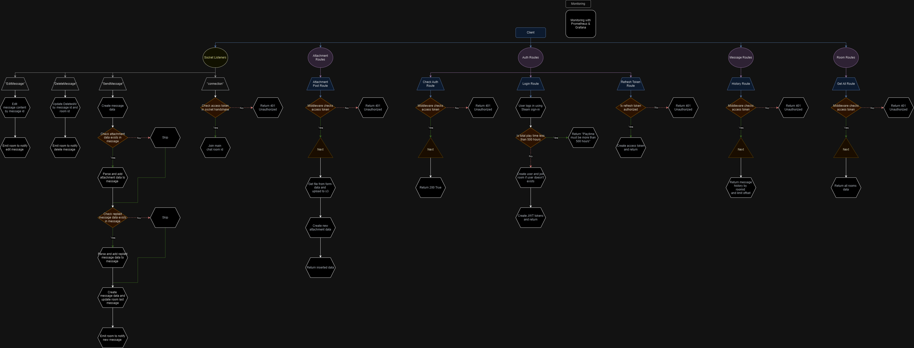

# Settle Backend

[](https://go.dev/)
[](https://github.com/kwa0x2/Settle-Backend/actions/workflows/ci.yml)
[](https://goreportcard.com/report/github.com/kwa0x2/settle-backend)
[](https://www.mongodb.com/)
[](LICENSE)

> A real-time chat backend built with Go — exclusively for serious Steam gamers. Only users with **500+ hours on Steam** can join the conversation.

---

## Overview

Settle Backend is the API and real-time service behind Settle, a chat platform that gates access via Steam playtime. Authentication is handled through Steam's OpenID flow; messaging runs over Socket.IO; media and attachments live in S3; and everything is observed with Prometheus + Grafana.

The codebase follows **Clean Architecture** with strict separation between `delivery → usecase → repository → domain`.

## Features

- **Steam OpenID authentication** with a 500-hour playtime gate
- **Real-time messaging** via Socket.IO (rooms, presence, typing)
- **JWT auth** with separate access & refresh token expiries
- **File attachments** uploaded to Amazon S3
- **Rooms & direct messages** with persistent history (MongoDB)
- **Observability** — Prometheus metrics, Grafana dashboards, Node Exporter
- **Containerized stack** with Docker Compose
- **Input validation** with `go-playground/validator`

## Tech Stack

| Layer            | Technology                                                                 |
|------------------|----------------------------------------------------------------------------|
| Language         | Go 1.23+                                                                   |
| HTTP Framework   | [Gin](https://github.com/gin-gonic/gin)                                    |
| Real-time        | [Socket.IO](https://github.com/zishang520/socket.io) (Go)                  |
| Database         | MongoDB (official driver v2)                                               |
| Object Storage   | Amazon S3 (AWS SDK v2)                                                     |
| Auth             | Steam OpenID, JWT (access + refresh)                                       |
| Config           | Viper                                                                      |
| Validation       | go-playground/validator                                                    |
| Monitoring       | Prometheus, Grafana, Node Exporter                                         |
| Containerization | Docker & Docker Compose                                                    |

## Architecture



This project follows the Clean Architecture pattern — the dependency rule always points inward, from delivery toward the domain.


### Layout

- **`cmd/`** — application entry point (`main.go`)
- **`api/`** — HTTP delivery, middleware, route registration, Socket.IO gateway
- **`domain/`** — core entities and repository / usecase interfaces
- **`usecase/`** — business logic
- **`repository/`** — MongoDB & S3 implementations
- **`bootstrap/`** — dependency wiring and service initialization
- **`monitoring/`** — Prometheus & Grafana configuration
- **`utils/`** — shared helpers

## Getting Started

### Prerequisites

- [Docker](https://www.docker.com/) & Docker Compose
- A [Steam Web API key](https://steamcommunity.com/dev/apikey)
- AWS credentials with S3 access
- MongoDB connection (a containerized one is included in `compose.yaml`)

### 1. Clone the repository

```bash
git clone https://github.com/kwa0x2/Settle-Backend.git
cd Settle-Backend
```

### 2. Configure environment variables

Copy `.env.example` to `.env` and fill in your credentials:

```bash
cp .env.example .env
```

```env
APP_ENV=development
SERVER_ADDRESS=:9090

# Steam OpenID
STEAM_API_KEY=
STEAM_REDIRECT_URL=http://localhost:9090/api/v1/auth/login/steam/callback
REDIRECT_LOGIN_URL=http://localhost:3000/en/auth/login

# MongoDB
MONGO_URI=
MONGO_DB_NAME=settle

# AWS S3
AWS_ACCESS_KEY_ID=
AWS_SECRET_ACCESS_KEY=
AWS_REGION=
S3_BUCKET_NAME=

# JWT
ACCESS_TOKEN_EXPIRY_HOUR=2
REFRESH_TOKEN_EXPIRY_HOUR=168
ACCESS_TOKEN_SECRET=
REFRESH_TOKEN_SECRET=
```

### 3. Start the stack

```bash
docker compose up -d --build
```

| Service     | URL                              |
|-------------|----------------------------------|
| API Server  | http://localhost:9090            |
| Prometheus  | http://localhost:9091            |
| Grafana     | http://localhost:3001            |

## API

All endpoints are prefixed with `/api/v1`. Route groups:

| Group              | Purpose                              |
|--------------------|--------------------------------------|
| `/auth`            | Steam OpenID login, token refresh    |
| `/rooms`           | Create, list and manage chat rooms   |
| `/messages`        | Message history                      |
| `/attachments`     | Upload files to S3                   |
| `/socket.io`       | Real-time gateway                    |

## Project Structure

```
Settle-Backend/
├── api/
│   ├── http/          # Gin HTTP handlers
│   ├── middleware/    # Auth, CORS, rate-limit, metrics
│   ├── route/         # Route registration
│   └── socket/        # Socket.IO gateway & adapters
├── bootstrap/         # App initialization & DI
├── cmd/               # Entry point
├── domain/            # Entities and contracts
├── monitoring/        # Prometheus & Grafana configs
├── repository/        # MongoDB & S3 implementations
├── usecase/           # Business logic
├── utils/             # Helpers
├── compose.yaml       # Docker Compose stack
└── Dockerfile         # API image
```

## License

Distributed under the MIT License. See [`LICENSE`](LICENSE) for more information.
